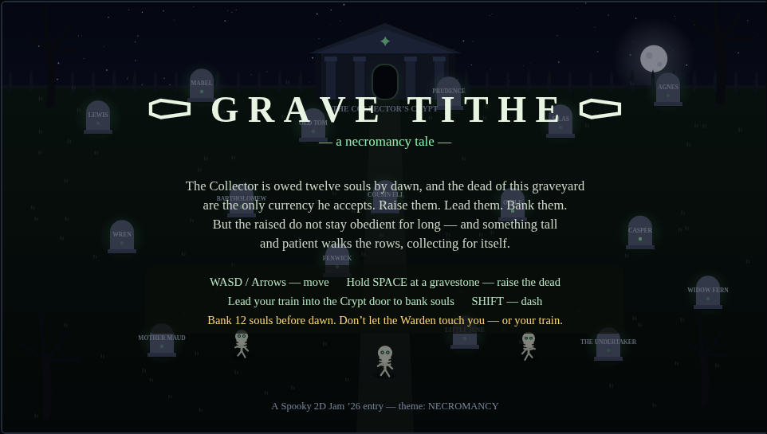

# GRAVE TITHE

**A necromancer's night shift — raise the dead, pay the tithe, beat the dawn.**

The Collector is owed twelve souls by dawn, and the churchyard is full of the unpaid dead. You are the tithe-collector's apprentice: hold your ground at a gravestone to **raise a skeleton**, lead your rattling train across the yard, and bank their souls at the Collector's Crypt. But the Warden walks the rows — if it touches you, it takes a heart; if it touches your train, it takes a soul. And the dead do not stay obedient: every skeleton you raise turns **feral** on its own timer and comes for you. Dash through danger, spend your train wisely, and pay the tithe before the sky pales.

Built for [Spooky 2D Jam '26](https://itch.io/jam/spooky2djam26) — theme: **NECROMANCY**. One self-contained HTML file: canvas, Web Audio synth, no libraries, no assets.

## Play it

- **itch.io:** https://retroromrunner.itch.io/grave-tithe
- **In the browser (GitHub Pages):** https://retroromrunner.github.io/grave-tithe/
- **Mirror:** https://mantra-ravine-r4ec.here.now/

## Controls

- **WASD / Arrows** — move
- **Hold SPACE** at a gravestone — raise the dead (keep holding until the ring fills)
- **SHIFT** — dash (brief, with a cooldown; you pass *through* the Warden safely mid-dash)
- Lead skeletons into the Crypt door to bank them. Banked souls are safe; carried ones are not.
- **P** pause · **M** mute · **Enter** start / restart

**On mobile (touch):** drag anywhere to steer, hold the **RAISE** pad with your other thumb at a gravestone, **DASH** pad bottom-left. Fully two-thumb — you can hold RAISE and keep moving.

## The night

- 90 seconds until dawn. Bank **12 souls** to win. Every skeleton turns feral fast — raise a few, race them to the Crypt, repeat: it's a speedrun.
- Two difficulties on the title screen: **NORMAL** (90s) and **HARD** (60s, the dead turn even faster — and the moon runs red).
- The Warden hunts you and your train — dash through it or give it a wide berth.
- Raised skeletons turn feral after a while and hunt *you* — bank them before they turn, or dodge your own dead.
- 3 hearts. Lose them all, or let dawn break with the tithe unpaid, and the Collector takes *you* instead.

## Tech

Single `index.html` (~35 KB) — vanilla JS canvas rendering, procedural Web Audio (organ-ish drones, chimes, thuds), keyboard + multi-touch input. No build step; open the file and play.
